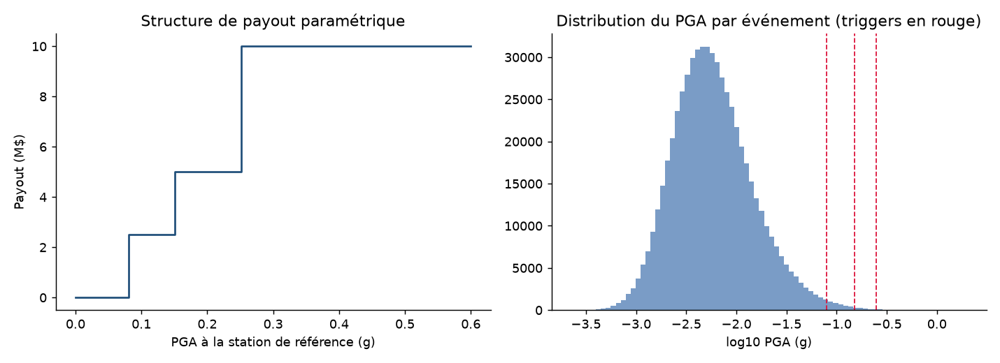
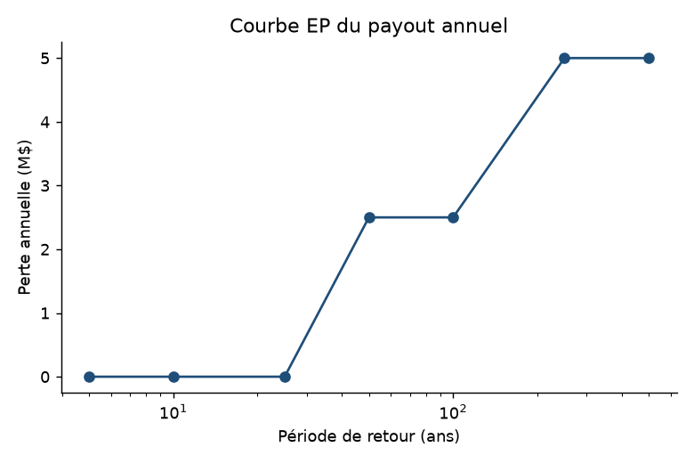
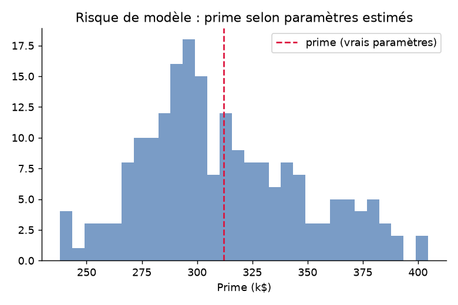
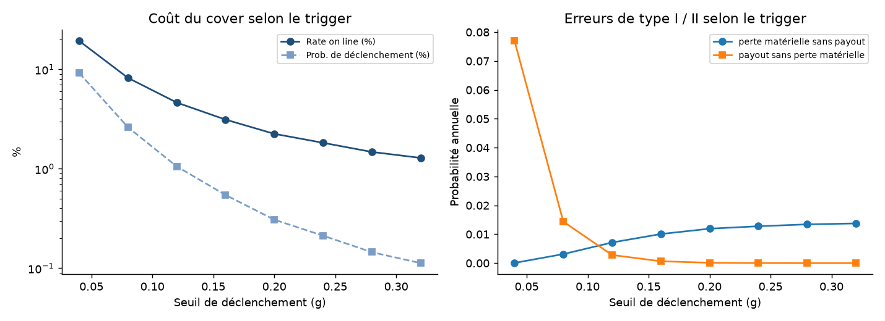
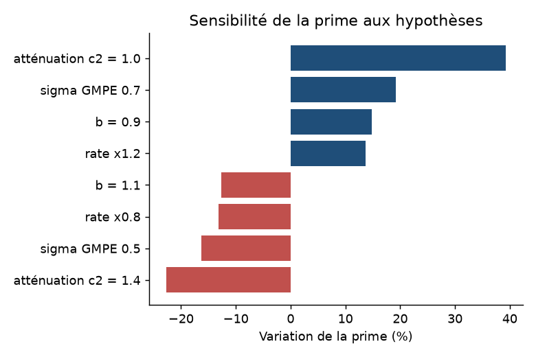

# Pricing d'une couverture paramétrique séisme

Étude de modélisation actuarielle en Python d'une couverture indexée sur le PGA (*Peak Ground Acceleration*). Le projet relie la simulation d'événements sismiques à la structure de paiement du contrat, puis analyse le prix, le risque extrême, le basis risk et la sensibilité aux hypothèses.

**Rapport :** [PDF](outputs/rapport_catastrophe_naturelle.pdf) · [source LaTeX](outputs/rapport_catastrophe_naturelle.tex)

## Chaîne de modélisation

```text
Fréquence, magnitude et distance des séismes
                      ↓
             PGA à l'index de référence
                      ↓
       Paliers de paiement du contrat
                      ↓
  Agrégation annuelle et limite contractuelle
                      ↓
 Tarification · risque · basis risk · sensibilités
```

Le PGA est l'accélération maximale du sol. L'indemnité dépend uniquement de cet indice et des seuils contractuels; elle ne dépend pas de la perte effectivement observée.

## Structure de la couverture

Limite annuelle de **10 M$**, agrégée et plafonnée par année.

| PGA à l'index | Part de la limite payée |
|---:|---:|
| 0,08 g | 25 % |
| 0,15 g | 50 % |
| 0,25 g | 100 % |



## Méthode

| Composante | Modélisation |
|---|---|
| Fréquence | Processus de Poisson, taux de 3 événements M ≥ 5 par an dans un rayon de 150 km |
| Magnitude | Loi de Gutenberg–Richter tronquée entre 5 et 8, b = 1 |
| PGA | GMPE simplifiée : ln(PGA) = −1,9 + (M−6) − 1,2 ln(R/10) + ε, avec σ = 0,6 |
| Tarification | AAL + 0,35 × écart-type; comparaison avec une charge de coût du capital de 10 % × (TVaR99 − AAL) |
| Incertitude paramétrique | 200 catalogues pseudo-observés de 60 ans; réestimation du taux et de la b-value, puis repricing |
| Basis risk | PGA au portefeuille distinct de l'index; fonction de vulnérabilité sigmoïde avec erreur spatiale et bruit multiplicatif |
| Design du trigger | Couverture binaire; balayage du seuil et comparaison des coûts, faux paiements et pertes non indemnisées |

## Résultats

Résultats sur **200 000 années simulées**, avec la graine fixée dans le code :

| Mesure | Estimation |
|---|---:|
| Probabilité annuelle de paiement | 2,52 % |
| AAL (perte annuelle moyenne) | 88,5 k$ |
| Prime, principe de l'écart-type | 312,1 k$ |
| Rate on line | 3,12 % |
| VaR 99 % / TVaR 99 % | 2,50 M$ / 5,05 M$ |
| Prime P5–P95 après réestimation paramétrique | 258,5–378,9 k$ |
| Corrélation perte simulée / indemnité | 0,683 |

La TVaR99 est calculée comme la moyenne des 1 % d'années les plus coûteuses. Le résultat de basis risk dépend de la définition stylisée de la perte matérielle (5 % de la limite) et de la fonction de vulnérabilité retenue.





## Basis risk et choix du trigger

La couverture paramétrique peut verser une indemnité sans perte matérielle correspondante ou ne pas payer lorsqu'une perte matérielle survient. Le balayage du trigger binaire illustre le compromis entre coût de la couverture et risque de perte sans indemnisation. Les sensibilités sont évaluées en modifiant une hypothèse à la fois.





Le coefficient d'atténuation c2 de la GMPE produit la plus forte variation dans les scénarios étudiés (−22,7 % à +39,2 % sur la prime), suivi de l'écart-type σ (−16,2 % à +19,2 %).

## Reproductibilité

Python 3.10 ou supérieur :

```bash
python -m venv .venv
# Windows PowerShell : .venv\Scripts\Activate.ps1
# macOS/Linux : source .venv/bin/activate
python -m pip install -r requirements.txt
python run_analysis.py
```

La commande régénère les tables et figures dans `outputs/`.

Le rapport PDF peut être régénéré à partir des sorties avec :

```bash
python build_report.py
```

## Fichiers

- `parametric_eq.py` — fonctions de simulation, de tarification et d'analyse.
- `run_analysis.py` — exécution reproductible de l'étude et génération des sorties.
- `build_report.py` — mise en page du rapport PDF à partir des résultats calculés.
- `requirements.txt` — dépendances Python.
- `outputs/` — résultats numériques, figures, rapport PDF et source LaTeX.

## Limites

Le catalogue sismique, la GMPE et la vulnérabilité sont stylisés et ne sont calibrés sur aucune région ni donnée de sinistre réelle. Les estimations sont conditionnelles aux hypothèses choisies et illustrent une méthode; elles ne constituent pas une tarification de marché. Une application réelle nécessiterait un catalogue historique, une GMPE publiée et une calibration de la vulnérabilité au portefeuille.
